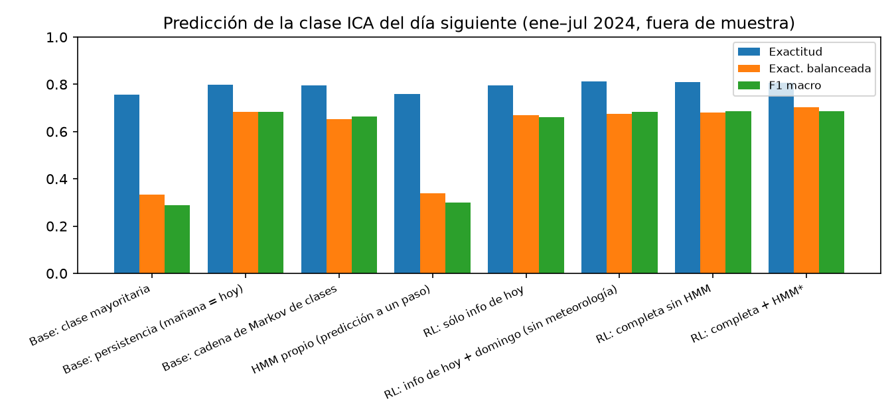

# Agente de calidad del aire del Valle de Aburrá

**SI3003 Inteligencia Artificial · EAFIT 2026-1 · Daniel Muñeton · Tomas Vera · Grupo jueves**
Repositorio: https://github.com/Danimuneton/Proyecto_Final_IA

## 1. Problema

En el Valle de Aburrá (10 municipios, cerca de 4 millones de habitantes) el PM2.5 se acumula en dos temporadas al año (febrero–abril y octubre–noviembre) por la topografía de cuenca cerrada y la estabilidad atmosférica. El SIATA publica el Índice de Calidad del Aire (ICA), pero muchos ciudadanos no saben qué significa el valor del día, si mañana empeorará ni qué hacer. Construimos un MVP que (i) estima el **estado latente** de la calidad del aire por estación, (ii) **predice la categoría ICA del día siguiente** y (iii) responde preguntas en lenguaje natural mediante un **agente LLM con RAG** que consulta datos, modelos y documentos normativos, y **cita sus fuentes**.

## 2. Datos

- **SIATA**, archivo abierto `Datos_SIATA_Aire_pm25.json`: PM2.5 horario de 21 estaciones con bandera de calidad, del 31-jul-2023 al 31-jul-2024. Se descartan horas con bandera > 2,5 o valor negativo; el promedio de 24 h exige ≥ 18 horas válidas. Quedan **17 estaciones y 5.870 días estación**.
- **Open-Meteo / ERA5** (reanálisis Copernicus, CC BY 4.0): lluvia, viento, radiación y nubosidad diarias en el centro del valle.
- **Corpus RAG** (7 documentos, 56 fragmentos): extracto del texto oficial de la Resolución 2254 de 2017 (norma, ICA, niveles de prevención/alerta/emergencia); síntesis del POECA del AMVA; recomendaciones de salud por color del ICA (Res. 2254 y US EPA AirNow); guías OMS 2021; descripción de los datos SIATA; meteorología del valle; metodología del proyecto.

El acceso se verificó al inicio; como plan B, los CSV procesados están versionados en el repositorio. Distribución diaria: Buena 1.158, Aceptable 4.540, Dañina para grupos sensibles 171, Dañina 1. Los días Naranja se concentran en enero–abril de 2024 (máximo en marzo, media 30,9 µg/m³). La autocorrelación diaria del promedio del valle es 0,83 y el 80 % de los días repite la categoría del día anterior.

## 3. Método de la Parte 1

**HMM gaussiano propio** (`src/aire/hmm.py`, solo NumPy). Tres estados ocultos (Normal, Alerta, Episodio crítico) con emisión gaussiana sobre x_t = log PM2.5 diario. Implementamos forward-backward con escalamiento, **Baum-Welch** para múltiples secuencias (una por estación) con datos faltantes (emisión = 1 cuando no hay dato), Viterbi en log-espacio, filtrado P(z_t | x_1:t) y predicción a un paso. Verificamos la corrección: la log-verosimilitud del forward coincide con la enumeración exhaustiva de los 3⁶ caminos, Viterbi coincide con la búsqueda exhaustiva, EM es monótono y recupera los parámetros de datos simulados. Sobre los datos reales los estados tienen medias ~12, 18 y 30 µg/m³ y permanencia diaria ~0,94.

**Regresión logística multinomial propia** (`src/aire/classifier.py`): softmax con entropía cruzada, L2 y optimizador Adam, con estandarización ajustada en entrenamiento. Predice la clase de mañana: Buena (0–12), Aceptable (13–37) o Dañina para grupos sensibles o peor (≥ 38, nivel de Prevención de la Res. 2254). Variables: PM2.5 de hoy, de ayer, cambio, media de 3 días, promedio del valle, clase de hoy, **probabilidades filtradas del HMM** (integración HMM → clasificador), lluvia de hoy, meteorología de mañana (reanálisis usado como pronóstico, o escenario del usuario) e indicador de domingo. Por el desbalance, la decisión usa P(c|x)/prior(c)^α, con α elegido por validación interna (últimos 30 días del entrenamiento). La implementación coincide con `sklearn.LogisticRegression` en el 100 % de las predicciones (diferencia máxima de probabilidad 0,006).

**Protocolo experimental.** Validación con **origen móvil mensual**: para cada mes de enero a julio de 2024 se re-entrenan HMM y clasificador solo con datos anteriores y se predice el mes (3.309 predicciones). Líneas base: clase mayoritaria, **persistencia** (mañana = hoy) y cadena de Markov sobre clases (versión probabilística de la persistencia). Intervalos de confianza del 95 % por **bootstrap de días** (2.000 réplicas; remuestrear días respeta la correlación entre estaciones).

## 4. Diseño del agente y del RAG

**RAG.** Cada sección `##` de un documento es un fragmento con metadatos (id, título, sección, fuente, URL). Embeddings `paraphrase-multilingual-MiniLM-L12-v2` en un índice **FAISS** (IndexFlatIP, coseno) combinados con TF-IDF mediante *reciprocal rank fusion*; si el modelo de embeddings no está disponible, el sistema cae a TF-IDF sin fallar.

**Herramientas.** `get_pm25(estacion, fecha)` (dato SIATA, ICA, norma y guía OMS; acepta estación, barrio, municipio o "todas"), `predict_tomorrow(estacion, fecha, escenario)` (probabilidades, factores principales, estado HMM y persistencia), `get_episode_state(fecha, estacion)` (estados HMM del valle y Viterbi causal) y `search_docs(query, k)` (fragmentos con etiqueta de cita).

**Loop agéntico** (`src/aire/agent.py`, manual, sin LangGraph). En cada iteración el LLM (por defecto `openai/gpt-oss-120b` en Groq; también NVIDIA NIM u Ollama) decide llamar herramientas o responder, con **T_max = 6**; al alcanzarlo se fuerza una respuesta final sin herramientas. Los errores de herramienta (estación inexistente, fecha fuera de rango, JSON inválido, excepción interna) se devuelven como **observación** y el modelo puede corregirse. Los errores de API (llave, red) se convierten en mensajes claros y el dashboard sigue funcionando. Para la capa gratuita de Groq (8.000 tokens/min) las observaciones se compactan, ante un 429 se espera lo que indica `retry-after` y, si el límite persiste, se cambia a `gpt-oss-20b`; si todo falla, se muestra un resumen de lo que devolvieron las herramientas. Las herramientas no aceptan fechas posteriores a la fecha de consulta, para que el agente no "vea el futuro" en la demo histórica. Un **verificador de citas** revisa cada respuesta final: si cita documentos que no recuperó, usa una etiqueta genérica o cita sin haber llamado herramientas, le devuelve el problema al modelo (máximo 2 veces). El prompt de sistema exige citar con la etiqueta del fragmento, `[SIATA]` o `[Modelo del proyecto]`, aclarar que no es consejo médico y rechazar preguntas fuera de tema.

**Dashboard** (Streamlit + Plotly). Parámetros: municipio, estación, fecha de consulta, ventana y escenario meteorológico de mañana (incluido domingo/festivo). Pestañas: mapa de estaciones por color ICA con ranking; serie de tiempo con bandas ICA, norma, guía OMS y estado del HMM, probabilidades de estados y perfil horario; predicción con probabilidades, factores, persistencia, valor real y backtesting por estación; evaluación; y chat con trazas de herramientas y fuentes.

## 5. Resultados

**Tabla 1.** Predicción de la clase ICA del día siguiente (fuera de muestra, ene–jul 2024, n = 3.309).

| Modelo | Exact. | Exact. bal. | F1 macro | Recall Dañina | Log-loss | Brier |
|---|---|---|---|---|---|---|
| Mayoritaria | 0,757 | 0,333 | 0,287 | 0,000 | — | — |
| Persistencia | 0,799 | 0,685 | 0,684 | 0,601 | — | — |
| Cadena de Markov | 0,796 | 0,654 | 0,664 | 0,506 | 0,536 | 0,300 |
| HMM (a un paso) | 0,758 | 0,339 | 0,300 | 0,000 | 0,522 | 0,313 |
| RL completa sin HMM | 0,811 | 0,681 | 0,686 | 0,571 | 0,445 | 0,267 |
| **RL completa + HMM (final)** | 0,808 | **0,703** | **0,686** | **0,631** | 0,439 | 0,265 |

{width=72%}

El modelo final mejora la calidad probabilística frente a la cadena de Markov: log-loss −0,098 (IC 95 % [−0,133; −0,064]) y Brier −0,036 ([−0,051; −0,021]). Frente a la persistencia, la exactitud (+0,009, [−0,008; +0,024]), la F1 macro (+0,002, [−0,031; +0,038]) y la exactitud balanceada (+0,017, [−0,018; +0,061]) mejoran levemente pero **sin significancia estadística**. La ablación muestra que las variables del HMM aumentan la exactitud balanceada (+0,022, [+0,001; +0,053]) y reducen la log-loss (−0,005, [−0,009; −0,002]). Como predictor directo, el HMM nunca predice la clase Dañina porque su estado más alto tiene media ~30 µg/m³; su valor está en describir la dinámica (log-verosimilitud predictiva −0,20 frente a −0,71 de una gaussiana i.i.d.) y en alimentar al clasificador. En marzo de 2024, 15 de 17 estaciones estaban en el estado Episodio crítico.

**RAG.** Sobre 18 consultas con documento esperado, el recuperador híbrido logra hit@4 = 1,00 (MRR 0,84), frente a 0,94 de FAISS solo y de TF-IDF solo. El agente recibe 4 fragmentos, así que todos los documentos esperados llegan al contexto.

**Agente.** 14 preguntas fijas (datos, comparación de estaciones, predicción, escenario, episodio, normativa, POECA, salud combinada, meteorología, confiabilidad del modelo, estación inexistente, fecha fuera de rango y una fuera de tema). Con `qwen2.5:7b` local (Ollama, CPU): **herramienta correcta 11/14**, **citó la fuente 11/11** de las que lo requieren, **citas válidas 10/11** y valores numéricos correctos 3/3. Los dos casos de error se manejaron bien (explicó que la estación o la fecha no estaban disponibles y ofreció alternativas) y la pregunta fuera de tema se rechazó sin herramientas. El verificador de citas intervino en 7 de las 14 preguntas y en 6 de ellas la respuesta final quedó con citas válidas. La revisión manual encontró fallas que las métricas automáticas no capturan del todo: en P07 el modelo simuló fragmentos en texto en lugar de llamar a `search_docs` (cita marcada como inválida); en P08 omitió `search_docs` y presentó como pronóstico el PM2.5 real del día siguiente, que la herramienta exponía para el backtesting (se corrigió: ese valor ya no se envía al LLM y las herramientas rechazan fechas posteriores a "hoy"); en P12 usó `predict_tomorrow` en lugar de la metodología y exageró el desempeño frente a la persistencia. Esto muestra que un modelo de 7B en CPU no es suficiente para la demostración. Con `openai/gpt-oss-120b` (Groq): _[completar con evaluacion/resultados_agente_openai_gpt-oss-120b.md]_.

## 6. Limitaciones y trabajo futuro

- Un año de datos (2023–2024) y solo 172 días Dañinos; sin episodios Rojo prolongados ni Púrpura. La app trabaja con una fecha de consulta histórica, no con datos en tiempo real.
- La meteorología de mañana es un reanálisis en un punto usado como pronóstico perfecto; sus coeficientes son pequeños y algunos tienen signos contraintuitivos (confusión con la estacionalidad). Un pronóstico real empeoraría el desempeño.
- Los estados del HMM son regímenes estadísticos, no declaratorias del AMVA. El HMM de la demo se entrenó con todo el año.
- Corpus pequeño y consultas de evaluación escritas por el equipo; el agente depende de la calidad del LLM.
- Trabajo futuro: más años de datos, pronósticos meteorológicos reales y variables de capa de mezcla, un HMM jerárquico por estación, y evaluación de las respuestas con usuarios.

**Uso responsable.** Solo datos ambientales abiertos y agregados por estación. El sistema no es consejo médico, legal ni de seguridad, ni pronóstico oficial; remite al SIATA y al AMVA. El uso de IA generativa se declara en `DECLARACION_USO_IA.md`.

**Referencias.** MinAmbiente, Resolución 2254 de 2017. AMVA, Acuerdo Metropolitano 04 de 2018 (POECA). OMS (2021), *WHO global air quality guidelines*. US EPA, *Air Quality Guide for Particle Pollution*. SIATA, datos abiertos de PM2.5. Open-Meteo / ERA5 (Copernicus). Rabiner, L. (1989), A tutorial on hidden Markov models, *Proc. IEEE* 77(2).
