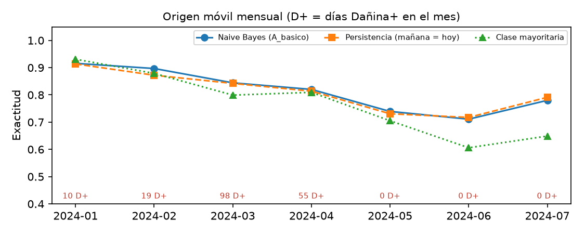

# Agente de calidad del aire del Valle de Aburrá

**SI3003 Inteligencia Artificial · EAFIT 2026-1 · Daniel Muñeton · Tomas Vera · Grupo jueves**
Código: https://github.com/Danimuneton/Proyecto_Final_IA (carpeta `proyecto_tomas/`)

## 1. Problema

En el Valle de Aburrá el PM2.5 se acumula en temporadas de transición (febrero–abril y septiembre/octubre–noviembre) por la topografía de cuenca cerrada. El SIATA publica el Índice de Calidad del Aire (ICA), pero el ciudadano no sabe qué significa el valor del día, si mañana empeorará ni qué hacer. Construimos un MVP que (i) predice la categoría de PM2.5 del día siguiente por estación con un **Naive Bayes categórico propio** y (ii) responde preguntas con un **agente LLM con RAG** sobre documentos oficiales, que consulta datos, predice y cita archivo y página. Es una herramienta orientativa: no es consejo médico, legal ni de seguridad, ni pronóstico oficial.

## 2. Datos

- **SIATA**, archivo abierto `Datos_SIATA_Aire_pm25.json` (descargado el 12-nov-2026): PM2.5 horario de 21 estaciones, 31-jul-2023 a 30-jul-2024. Se descartan valores negativos (centinela −9999) y mayores de 500 µg/m³ (centinelas como 99.999.000). El promedio diario exige al menos 18 de 24 horas (75 %). Se eliminan 4 estaciones sin datos válidos y la 44 (marcada `_OFF`): quedan **16 estaciones y 5.728 días-estación**, con 1.021 días Buena, 4.520 Aceptable y 187 Dañina a sensibles o peor (Dañina+).
- **Plan B:** los CSV limpios están versionados en `data/processed/`; la descarga es opcional.
- **Corpus RAG (5 PDF oficiales, 147 páginas, 341 fragmentos):** hoja metodológica del ICA (IDEAM), Resolución Metropolitana 2356 de 2023 (AMVA, periodo de gestión de episodios), plan de acción POECA del municipio de La Estrella, informe diario SIATA/AMVA del 24-abr-2026 y plantilla de reporte ICA/POECA del SIATA.
- **Categorías** (PM2.5 24 h, Res. 2254 de 2017): Buena 0–12, Aceptable 13–37, Dañina+ más de 37 µg/m³. Solo datos ambientales públicos y agregados; no hay datos personales.

## 3. Método de la Parte 1

**Naive Bayes categórico implementado con NumPy** (`src/modelo.py`): priors y verosimilitudes por conteo con suavizado de Laplace (α = 1), inferencia en log-espacio y normalización estable. Variables discretas del día base t para predecir la clase del día t+1: categoría de hoy y de ayer, tendencia (sube/baja/estable con umbral de 3 µg/m³), si mañana es fin de semana y si mañana cae en temporada lluviosa. Se compararon tres conjuntos de variables (A básico, B con nivel fino de 7 tramos, C sin calendario).

**Protocolo.** (a) Partición temporal única: entrenamiento antes del 2024-04-30 (4.150 ejemplos) y prueba desde esa fecha (1.385). El conjunto de variables se eligió con una **validación interna** (sub-entrenamiento antes del 2024-02-21, validación 1.083 ejemplos), nunca con la prueba: ganó A (F1 macro 0,600). (b) Como la prueba no tiene ningún día Dañina+, añadimos una **validación con origen móvil mensual**: para cada mes de enero a julio de 2024 se re-entrena solo con días anteriores y se predice el mes (3.249 predicciones, 182 Dañina+). (c) IC del 95 % de la diferencia con la línea base por **bootstrap de días** (2.000 réplicas). Líneas base: persistencia (mañana = hoy) y clase mayoritaria. Métricas implementadas a mano: exactitud, F1 macro (clases presentes), recall de Dañina+ y matriz de confusión.

**Verificación de corrección.** Con el mismo suavizado y priors, nuestro Naive Bayes coincide con `sklearn.naive_bayes.CategoricalNB` en el 100 % de las 1.385 predicciones de prueba (diferencia máxima de probabilidad 9·10⁻¹⁶).

## 4. Diseño del agente y del RAG

**RAG** (`src/rag.py`). Texto por página con `pypdf`, fragmentos de 900 caracteres con solape de 150 (cortando en fin de oración), embeddings `paraphrase-multilingual-MiniLM-L12-v2` normalizados en un índice **FAISS** `IndexFlatIP` (coseno) y búsqueda **híbrida**: se fusionan los rankings de FAISS y de TF-IDF con *Reciprocal Rank Fusion*. Antes de buscar, las siglas (POECA, ICA, SIATA, AMVA…) se expanden con un glosario, porque los embeddings las manejan mal. Si la relevancia máxima es < 0,30, la herramienta avisa al modelo que los fragmentos pueden no responder.

**Herramientas.** `get_pm25(estacion, fecha)`: PM2.5 diario, categoría y promedio de 7 días. `predict_tomorrow(estacion, fecha)`: probabilidades del Naive Bayes para el día siguiente. `search_docs(consulta)`: 6 fragmentos con archivo y página. La estación se resuelve por nombre parcial sin tildes; si no existe o es ambigua, la herramienta lo devuelve con la lista de opciones.

**Loop agéntico manual** (`src/agente.py`): el LLM (`openai/gpt-oss-120b` en Groq, endpoint compatible con OpenAI, `reasoning_effort=low`, temperatura 0) decide en cada iteración si llama herramientas o responde, con **T_max = 6**; al alcanzarlo se pide una respuesta final sin herramientas. Cualquier error de herramienta (estación inexistente, fecha sin dato, JSON inválido, excepción) vuelve como **observación** y nunca rompe el loop. Ante límites de tasa del proveedor se reintenta con espera; ante una llave inválida se falla de inmediato con un mensaje claro y el dashboard sigue funcionando. El prompt obliga a basar cada afirmación documental en una frase textual corta entre «» seguida de (archivo.pdf, p. N), a reformular la búsqueda si no encuentra, a no mezclar unidades del ICA y del PM2.5, y a rechazar preguntas fuera de tema.

**Dashboard** (Streamlit + Plotly): el usuario elige estación, fecha y ventana. Pestañas: serie de tiempo con los puntos de corte; mapa de estaciones coloreadas por categoría y barras comparativas; predicción de mañana con probabilidades, valor observado y tabla de desempeño; y chat con trazas de herramientas. El chat recibe la estación y la fecha elegidas como contexto ("hoy" en el histórico).

## 5. Resultados

**Tabla 1.** Predicción de la categoría del día siguiente.

| Modelo | Partición única: exactitud | F1 macro | Origen móvil: exactitud | F1 macro | Recall Dañina+ |
|---|---|---|---|---|---|
| **Naive Bayes A (elegido)** | 0,737 | 0,693 | **0,815** | 0,666 | 0,489 |
| Naive Bayes B (nivel fino) | 0,710 | 0,592 | 0,802 | 0,542 | 0,231 |
| Naive Bayes C (sin calendario) | 0,711 | 0,611 | 0,802 | 0,577 | 0,341 |
| Persistencia (mañana = hoy) | **0,746** | **0,719** | 0,811 | **0,692** | **0,610** |
| Clase mayoritaria | 0,653 | 0,395 | 0,768 | 0,290 | 0,000 |

{width=78%}

El Naive Bayes supera con claridad a la clase mayoritaria, pero **no a la persistencia**. En el origen móvil la diferencia NB − persistencia es +0,004 en exactitud (IC 95 % [−0,007; +0,014]) y −0,026 en F1 macro ([−0,058; +0,000]): no es significativa. El modelo acierta más que la persistencia en febrero (0,897 vs 0,872) pero detecta menos días Dañina+ (89 de 182 frente a 111): con variables discretas de un día, la clase mayoritaria Aceptable domina las verosimilitudes. La conclusión honesta es que, con solo PM2.5 pasado y calendario, el PM2.5 de mañana se parece demasiado al de hoy para que este modelo agregue información. La elección por validación sí funcionó: el conjunto A fue el mejor también en ambas pruebas.

**RAG** (`src/evaluar_rag.py`): 14 consultas con la página correcta identificada a mano en los PDF. Búsqueda híbrida: hit@1 0,71, hit@6 0,93, MRR 0,80; solo embeddings: 0,50 / 0,93 / 0,69; solo TF-IDF: 0,57 / 1,00 / 0,71. La fusión mejora el primer resultado; el único fallo en el top-6 fue la tabla de efectos en salud del IDEAM (p. 4), que quedó en la posición 13.

**Agente** (15 preguntas fijas, `gpt-oss-120b`): datos medidos (3), predicción (2), documentales (5), combinadas datos + documentos (2), fuera de tema (1), estación inexistente (1) y fecha fuera de rango (1). **Herramienta correcta: 14/15**. Cita de fuente: 11/12. Cita verificable (archivo y página entre los fragmentos recuperados): 7/7. Frases entre «» presentes en los fragmentos: 5 completas y 2 parciales de 7. Rechazó la pregunta fuera de tema y explicó el error de la estación "Marte" con la lista de estaciones. La única falla de herramienta fue la pregunta 15: respondió que no hay datos de 2026 usando el rango de fechas del prompt, sin llamar a `get_pm25` (la respuesta es correcta, pero no verificada con la herramienta).

**Revisión manual** de las 7 respuestas documentales: 2 correctas y fundamentadas (POECA y temporadas; rango 0–12 de la categoría Buena); 2 correctas con alguna afirmación sin frase de respaldo (ICA naranja; procedimiento de declaratoria); 3 con errores de razonamiento: equiparó los colores del ICA con los niveles de contingencia (prevención, alerta, emergencia); afirmó que no hay recomendaciones para personas con asma y puso entre «» un texto propio; y dijo que no hay efectos para niños, aunque la hoja del IDEAM (p. 4) menciona síntomas en grupos sensibles. **Las métricas automáticas no detectan estos errores**: una cita puede ser verificable y el razonamiento estar mal.

## 6. Limitaciones

- Un solo año de datos históricos; no hay predicción en tiempo real ("hoy" es la fecha elegida en el dashboard).
- El modelo no supera a la persistencia y no usa meteorología (lluvia, viento, capa de mezcla). La variable de temporada lluviosa es un supuesto nuestro. La partición única no tiene días Dañina+; por eso se añadió el origen móvil.
- La limpieza no usa la bandera de calidad del SIATA: el 2,3 % de las horas conservadas (3.082) tienen bandera > 2,5. El corte "> 37" sobre promedios con decimales clasifica 37,1–37,4 como Dañina+, mientras la norma usa enteros.
- El prompt del agente se ajustó mirando las mismas 15 preguntas, así que sus resultados son optimistas; la revisión manual muestra errores de razonamiento que las métricas no capturan. Algunos PDF se extraen con espacios cortados o tildes dañadas.
- Depende de un LLM externo con límites de uso gratuitos.

**Trabajo futuro:** variables meteorológicas y de pronóstico, un modelo con dinámica temporal (HMM o regresión logística), más años de datos, un verificador automático de las frases citadas y evaluación con usuarios.

**Uso de IA generativa:** declarado en `DECLARACION_USO_IA.md`.

**Referencias.** MinAmbiente, Resolución 2254 de 2017. IDEAM, Hoja metodológica del Índice de Calidad del Aire. AMVA, Resolución Metropolitana 2356 de 2023. Municipio de La Estrella, Plan de acción POECA. SIATA, datos abiertos de PM2.5 e informe diario del 24-abr-2026.
